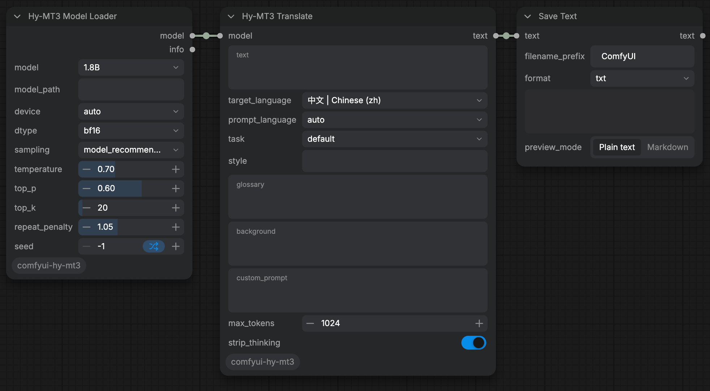

# ComfyUI Hy-MT3

[GitHub repository](https://github.com/yanhuifair/comfyui-hy-mt3)

ComfyUI nodes for Tencent's **Hy-MT3** translation models, loaded directly from the official full-weight (BF16 safetensors) repositories with Hugging Face Transformers: 1.8B, 7B and 30B-A3B (MoE), 102 languages.

[中文说明](README_CN.md)



## Nodes

| Node | Purpose |
| --- | --- |
| **Hy-MT3 Model Loader** | Loads a model from Hugging Face or a local folder, chooses device/dtype and sampling. Outputs a `HY_MT3_MODEL` handle. |
| **Hy-MT3 Translate** | Takes the model handle and text, builds the prompt with the model's own chat template and returns the translated string. |

Connect `HY_MT3_MODEL` from the loader to the translate node. One loader can feed any number of translate nodes.

## Supported models

| Model | Repository | BF16 parameters | Approx. weights |
| --- | --- | --- | --- |
| Hy-MT3-1.8B | [tencent/Hy-MT3-1.8B](https://huggingface.co/tencent/Hy-MT3-1.8B) | 1.79B | ~3.6 GB |
| Hy-MT3-7B | [tencent/Hy-MT3-7B](https://huggingface.co/tencent/Hy-MT3-7B) | 7.50B | ~15 GB |
| Hy-MT3-30B-A3B | [tencent/Hy-MT3-30B-A3B](https://huggingface.co/tencent/Hy-MT3-30B-A3B) | 30.06B (MoE, 128 experts, 8 active) | ~60 GB |

The 1.8B/7B models use `HunYuanDenseV1ForCausalLM`; 30B-A3B uses `HYV3ForCausalLM`. The loader downloads weights on first use via `from_pretrained`; set `HF_ENDPOINT` for a mirror.

## Installation

1. Put this folder in `ComfyUI/custom_nodes/`.
2. Install dependencies (PyTorch is already a ComfyUI dependency):
   ```bash
   pip install -r requirements.txt
   ```
   `transformers>=5.6.0` is required by the official model examples. `accelerate` is optional: when installed, `device=auto` uses `device_map="auto"`; otherwise the plugin picks CUDA → MPS → CPU.
3. Restart ComfyUI.

GGUF files, llama.cpp and `llama-cpp-python` are **not needed**.

## Model locations

- Select `1.8B`, `7B` or `30B-A3B` to load the official repository.
- Type a local model folder (or any HF repo id) into `model_path` to override the dropdown. Local subfolders under `ComfyUI/models/hy-mt3/` and paths from `HY_MT3_MODEL_PATHS` (`os.pathsep` separated) are discovered automatically and appear as `7B @ /path/to/model`.
- Hugging Face snapshot caches under `~/.cache/huggingface/hub/models--tencent--Hy-MT3-*/snapshots/*` are also scanned.

## Loader options

- `device`: `auto`, `cuda`, `mps` or `cpu`.
- `dtype`: `bf16` (recommended, matches the model card), `fp16` or `fp32`.
- `sampling`: `model_recommended` applies:
  - 1.8B / 7B: temperature `0.7`, top_p `0.6`, top_k `20`, repetition penalty `1.05`
  - 30B-A3B: temperature `0.7`, top_p `1.0`, top_k disabled, repetition penalty `1.0`
  - `custom` uses the four numeric inputs on the node.
- `seed`: -1 = random.

## Translate options

- `text`: source text; multiline and structured text are supported.
- `target_language`: 102 languages shown as `中文 | Chinese (zh)`. The node passes the full Chinese or English language name required by the model; `prompt_language` chooses the prompt language (`auto` detects CJK in the source).
- `task`: `default`, `terminology` (glossary pairs in `glossary`), `style` (constrains with `style`), `context` (uses `background`), `structured` (preserves format and placeholders), `custom` (`custom_prompt` with `{text}` / `{source_text}` and `{target_lang}`).
- `max_tokens`: default 1024.
- `strip_thinking`: removes `<think>…</think>` blocks and chat markers.

Input formatting uses `tokenizer.apply_chat_template(messages, add_generation_prompt=True)`, so the 7B template (which differs from 1.8B and 30B-A3B) is handled by each model's own tokenizer. Generation follows the official example: `max_new_tokens`, `do_sample=True`, official sampling values, and decoding only newly generated tokens.

## Troubleshooting

- **Out of memory** — use a smaller model, `dtype=fp16`, `device=cpu`, or reduce `max_tokens`.
- **Slow 30B-A3B** — use `device=cuda`/`mps` and install `accelerate` for `device_map=auto`.
- **Download fails** — set `HF_ENDPOINT`, or pre-download the model folder and pass it via `model_path`.
- **Unexpected `<think>` in output** — keep `strip_thinking` enabled.

<!-- 赞赏码：把图片放到 docs/wechat-pay.png，然后取消下面这行注释

-->
