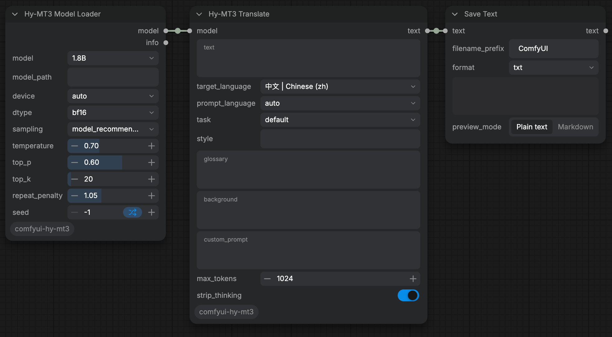

# ComfyUI Hy-MT3

[GitHub 仓库](https://github.com/yanhuifair/comfyui-hy-mt3)

面向腾讯 **Hy-MT3** 翻译模型的 ComfyUI 节点，直接用 Hugging Face Transformers 加载官方完整权重（BF16 safetensors）：1.8B、7B、30B-A3B（MoE），覆盖 102 种语言。

[English README](README.md)



## 节点

| 节点 | 作用 |
| --- | --- |
| **Hy-MT3 Model Loader** | 从 Hugging Face 或本地目录加载模型，设置设备、精度与采样，输出 `HY_MT3_MODEL` 句柄。 |
| **Hy-MT3 Translate** | 接收模型句柄与文本，用模型自带的 chat template 构造输入并返回译文。 |

把加载器的 `HY_MT3_MODEL` 连到翻译节点；一个加载器可以驱动多个翻译节点。

## 支持的模型

| 模型 | 仓库 | BF16 参数量 | 权重约 |
| --- | --- | --- | --- |
| Hy-MT3-1.8B | [tencent/Hy-MT3-1.8B](https://huggingface.co/tencent/Hy-MT3-1.8B) | 1.79B | ~3.6 GB |
| Hy-MT3-7B | [tencent/Hy-MT3-7B](https://huggingface.co/tencent/Hy-MT3-7B) | 7.50B | ~15 GB |
| Hy-MT3-30B-A3B | [tencent/Hy-MT3-30B-A3B](https://huggingface.co/tencent/Hy-MT3-30B-A3B) | 30.06B（MoE，128 专家，激活 8 个） | ~60 GB |

1.8B/7B 架构为 `HunYuanDenseV1ForCausalLM`，30B-A3B 为 `HYV3ForCausalLM`。首次使用通过 `from_pretrained` 自动下载；可用 `HF_ENDPOINT` 指定镜像。

## 安装

1. 把本目录放到 `ComfyUI/custom_nodes/`。
2. 安装依赖（PyTorch 已是 ComfyUI 依赖）：
   ```bash
   pip install -r requirements.txt
   ```
   官方示例要求 `transformers>=5.6.0`。`accelerate` 可选：安装后 `device=auto` 使用 `device_map="auto"`；否则按 CUDA → MPS → CPU 选择设备。
3. 重启 ComfyUI。

**不再需要 GGUF 文件、llama.cpp 或 `llama-cpp-python`。**

## 模型位置

- 下拉框选 `1.8B`、`7B` 或 `30B-A3B` 即加载官方仓库。
- 在 `model_path` 填本地模型目录（或任意 HF repo id）即可覆盖下拉框。`ComfyUI/models/hy-mt3/` 下的子目录、环境变量 `HY_MT3_MODEL_PATHS`（用 `os.pathsep` 分隔）中的目录会被自动发现，显示为 `7B @ /path/to/model`。
- `~/.cache/huggingface/hub/models--tencent--Hy-MT3-*/snapshots/*` 的现有缓存也会扫描。

## 加载器参数

- `device`：`auto`、`cuda`、`mps` 或 `cpu`。
- `dtype`：`bf16`（推荐，与模型卡一致）、`fp16`、`fp32`。
- `sampling`：`model_recommended` 使用官方参数：
  - 1.8B / 7B：温度 `0.7`、top_p `0.6`、top_k `20`、重复惩罚 `1.05`
  - 30B-A3B：温度 `0.7`、top_p `1.0`、关闭 top_k、重复惩罚 `1.0`
  - `custom` 使用节点上的四个数值输入。
- `seed`：-1 表示随机。

## 翻译节点参数

- `text`：待翻译文本，支持多行与结构化文本。
- `target_language`：102 种语言，显示为 `中文 | Chinese (zh)`。节点按模型要求传入完整的中文或英文语言名；`prompt_language` 控制提示词语言（`auto` 根据源文是否含中文字符判断）。
- `task`：`default`、`terminology`（`glossary` 术语对照）、`style`（用 `style` 约束风格）、`context`（使用 `background`）、`structured`（保持格式与占位符）、`custom`（`custom_prompt`，支持 `{text}` / `{source_text}` 与 `{target_lang}`）。
- `max_tokens`：默认 1024。
- `strip_thinking`：去掉 `<think>…</think>` 片段与聊天标记。

输入格式化使用 `tokenizer.apply_chat_template(messages, add_generation_prompt=True)`，因此 7B 与 1.8B/30B-A3B 不同的模板由各自 tokenizer 正确处理。生成过程照官方示例：`max_new_tokens`、`do_sample=True`、官方采样参数，并只解码新生成的 token。

## 常见问题

- **显存/内存不足**：换更小的模型、`dtype=fp16`、`device=cpu`，或减小 `max_tokens`。
- **30B-A3B 慢**：用 `device=cuda`/`mps` 并安装 `accelerate` 以启用 `device_map=auto`。
- **下载失败**：设置 `HF_ENDPOINT`，或提前下载模型目录并通过 `model_path` 指定。
- **输出含 `<think>`**：保持 `strip_thinking` 开启。

<!-- 赞赏码：把图片放到 docs/wechat-pay.png，然后取消下面这行注释

-->
